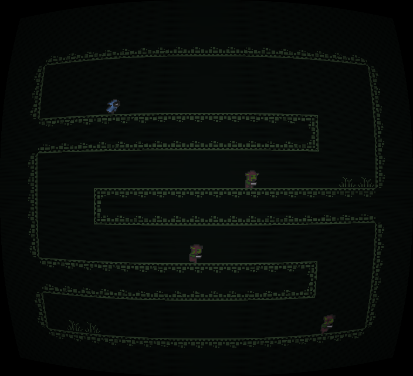

## Panacea

A 90's themed arcade platformer made for speedrunning, build using pygame!



## Controls

Arrow Keys for Movement

- X to dash

- R to retry

## Development

I had a lot fun working on this game, i faced many issues along the way like collision bugs and rendering errors. The biggest challenge was getting CRT Shaders to run for that old arcade display look.

# How to play

1. Download 'Panacea.zip' from Release
2. Extract the zip file.
3. Open the 'Panacea' folder.
4. Run the 'Panacea' executable.

### Running from source

If you want to run the game using Python, make sure Python and Pygame are installed.

```bash
python -m pip install pygame
python game.py
```

## Ai disclosure

- AI wasn't widelly used in this project, but i used ai to help resolve issue with CRT Shaders and to add the on screen timer :)